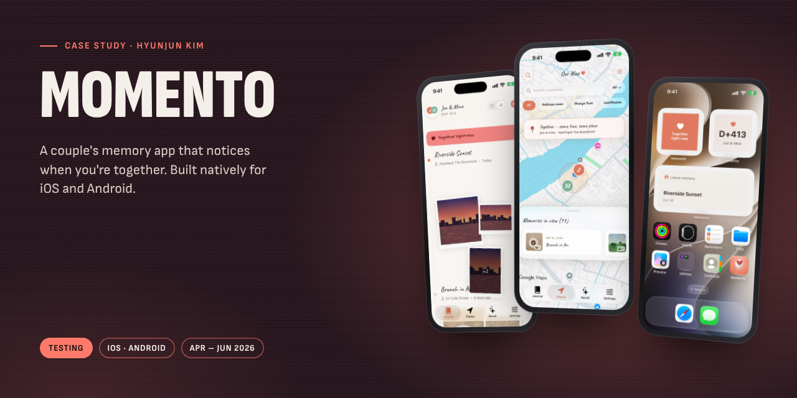
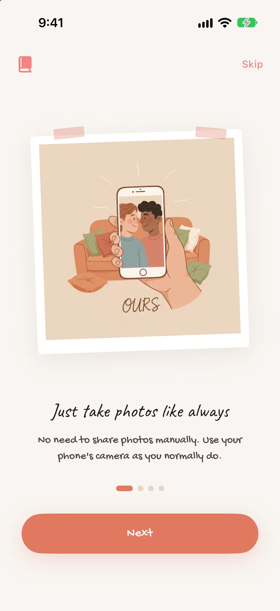
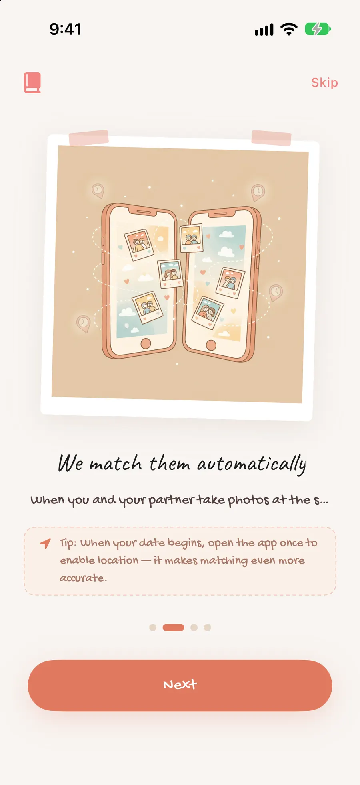
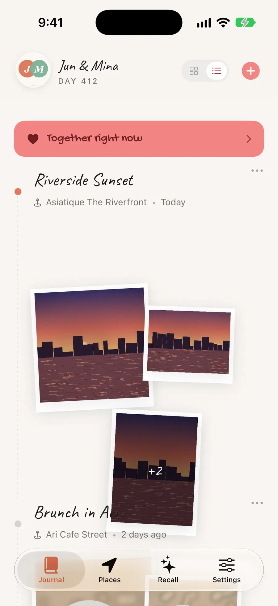
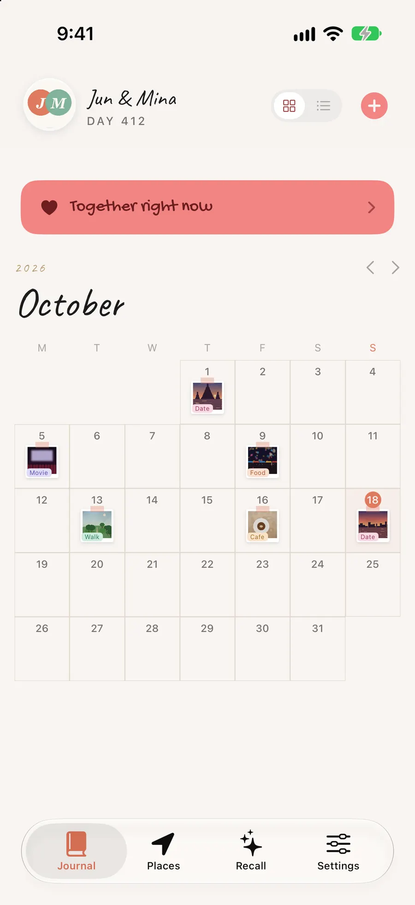
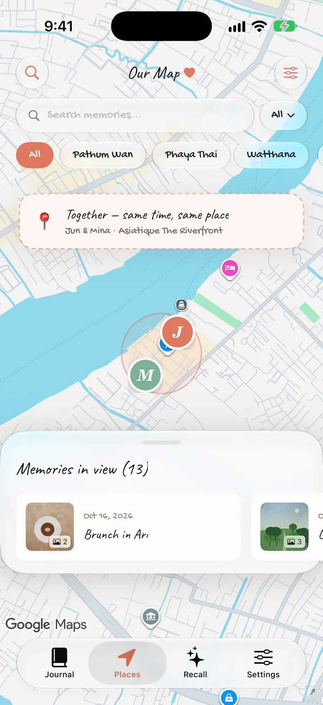
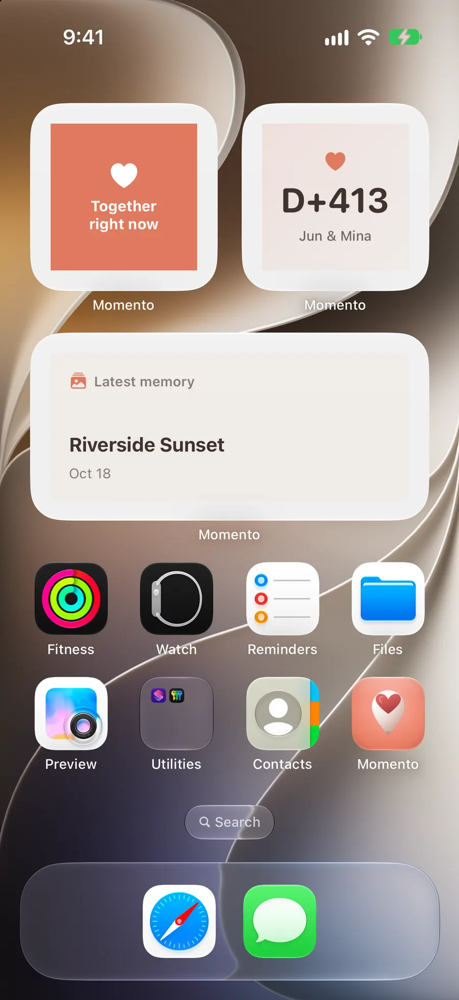
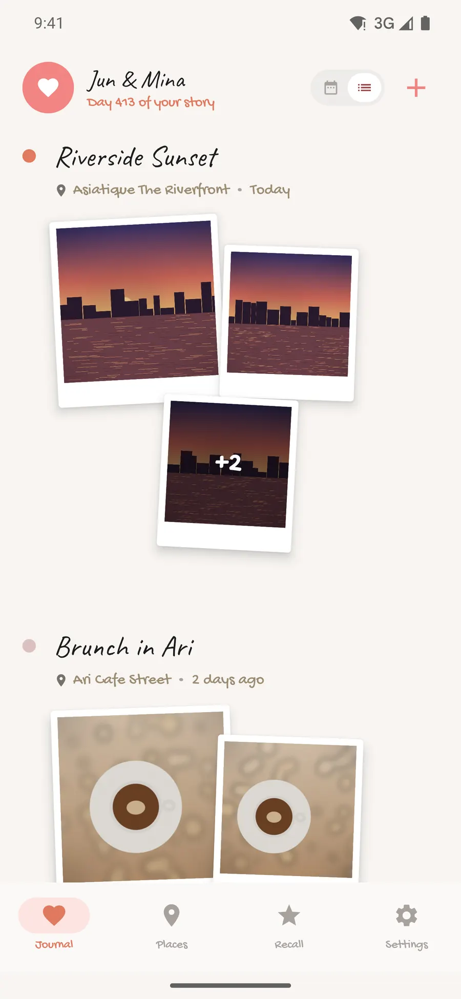
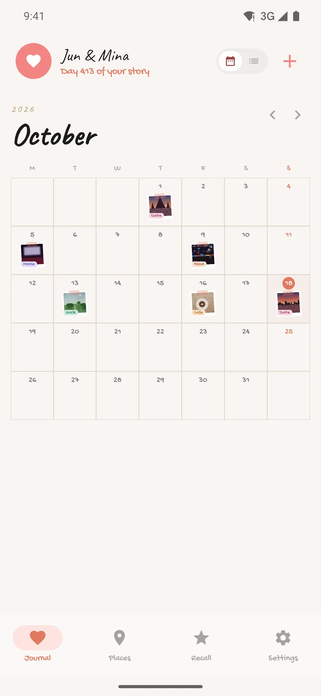
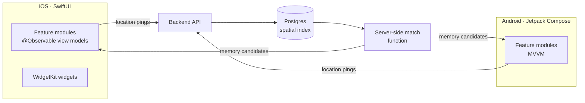

# Momento

A couple's memory app that notices when you're together. Built natively for iOS and Android.

**Status:** Testing (iOS on TestFlight) &nbsp;·&nbsp; **Platforms:** iOS · Android &nbsp;·&nbsp; **Built:** Apr – Jun 2026
 [Full case study](https://hyunjunkim.vercel.app/projects/momento/)

> [!NOTE]
> This repository is a **case study**, not the source code. The code is private. I'm happy to walk through the codebase live in an interview, or to give a hiring team temporary read access on request.

## The problem

Logging every shared moment by hand is tedious. Momento notices when a couple is in the same place at the same time and bundles the photos they take into a memory, with date and location, on a shared timeline, map and calendar.

## Screens

|   |   |   |   |
|:-:|:-:|:-:|:-:|
|  |  |  |  |
| Onboarding | Onboarding: automatic matching | Shared journal (iOS) | Calendar (iOS) |
|  |  |  |  |
| Memory map | Home-screen widgets | Journal (Android) | Calendar (Android) |

## Architecture

## Key decisions

- **Native on each platform, never ported.** The rule for the AI agents was explicit: don't copy iOS code into Android, build each the platform's own way (SwiftUI with @Observable, Compose with MVVM).
- **Matching runs on the server.** Comparing two phones' locations on-device gave different results per phone and drained the battery. Phones now send lightweight pings and a SQL function with a spatial index finds the matches.
- **Battery-aware location.** A 100 m movement filter on iOS and 15-minute background work on Android keep location tracking cheap.
- **Access rules on every table.** Every table in the database has row-level access rules, and keys stay on the server.

## By the numbers

| | |
|--:|:--|
| **2** | Native apps: SwiftUI and Jetpack Compose |
| **~7–8 weeks** | Development start to TestFlight |
| **24** | iOS feature modules |
| **4** | Languages, identical keys on both platforms |

## Problems solved along the way

**Dates from the server breaking screens.** The backend returned dates in more than one format, so iOS decoding failed. A flexible decoder that accepts every format fixed it, and external values are now parsed defensively by default.

**Android build failing on the DI library.** The dependency-injection library clashed with the latest build tooling, and version changes didn't help. Switching to manually managed singletons stabilized the build.

## What's next

- Bring Android to feature parity with iOS from the iOS feature list, not from copied code.
- Pin the live database schema into migration files in the repository.
- Automated tests for pairing, matching and purchases, with CI for both apps.

## Stack

`Swift` · `SwiftUI` · `WidgetKit` · `Kotlin` · `Jetpack Compose` · `Supabase (Postgres, Auth)`

## How it was built

I built this solo, with AI coding agents as my development team. I planned the feature set and the scrapbook visual style, set the platform rules for the AI agents, directed both apps and the backend, and tested on real devices until the TestFlight build.

More of my work: [portfolio](https://hyunjunkim.vercel.app) · [all case studies](https://github.com/g326555-lab)

---

© 2026 Hyunjun Kim. All rights reserved. See [LICENSE](LICENSE).
